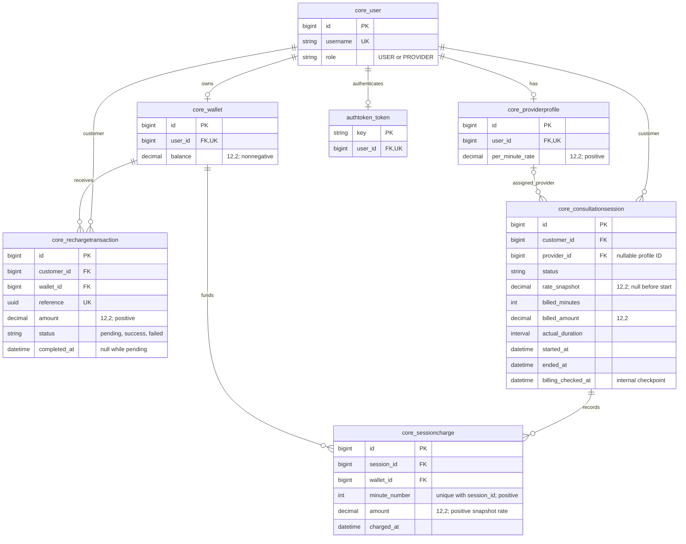
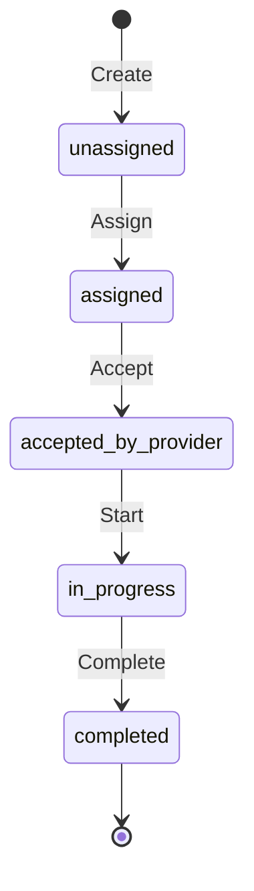

# Architectural design

[README](../README.md) covers setup, API contracts, and test coverage. This note describes the current implementation and its trade-offs.

## Boundaries and data model

Serializers validate request fields. Views and permissions enforce authentication and participant access, translate domain errors, and call services. `core/services.py` handles registration and recharges; `core/session_services.py` handles provider setup, session transitions, and billing. Models and migrations enforce database constraints. Views do not calculate charges or debit wallets.

Attributes are abbreviated; framework auth/admin/session tables are omitted. The API's `provider_id` is a **User ID**; the session foreign key points to ProviderProfile. Registration explicitly creates a wallet, and provider setup explicitly creates a profile; no creation signals are used.

Checks enforce valid user roles, monetary bounds, recharge completion consistency, session state/timestamp consistency, and nonnegative totals. A partial unique constraint allows at most one `in_progress` session per customer; `(session, minute_number)` is unique. Provider roles, participant ownership, and ledger/counter agreement require service validation rather than cross-table checks.

Wallet→User retains CASCADE. ProviderProfile→User, recharge→customer/wallet, session→customer/profile, and charge→session/wallet use PROTECT. Referenced history blocks normal Django parent deletion; explicit history-row deletion/direct SQL remains outside that protection.

## Session state machine

The customer creates a session and assigns a provider; the assigned provider accepts. The customer starts with an atomic minute-1 charge. While `in_progress`, `POST /api/sessions/{id}/bill/` settles due minutes without changing state unless funds run out.

Either participant can end the session after settling due charges. The system can also complete it for insufficient funds. If ending discovers insufficient funds, completion is recorded as a system end. There is no cancellation, reassignment, or restart. Billing a completed session has no effect; repeated start/end actions return `invalid_transition` errors.

## Atomicity and lock order

Services use `transaction.atomic()`. The locking scheme assumes PostgreSQL READ COMMITTED and that all financial writes follow the order below. Row locks are held until the transaction ends.

| Operation | Lock order | Atomic result |
|---|---|---|
| Registration / demo provider | New account and wallet/profile inserts | Both records or neither |
| Assign / accept | Session | Authorized state transition |
| Recharge initiation | Wallet → new RechargeTransaction | Pending transaction; no credit |
| Recharge finalization | Wallet → conditional RechargeTransaction update | First final state/timestamp and any credit together |
| Start | Session → Wallet → SessionCharge | Snapshot, first debit, ledger, counters, in-progress state |
| Bill / end | Session → Wallet → child charge inserts | Aggregate debit, ledger batches, counters/checkpoint and any completion |

The shared wallet serializes competing starts of different sessions. Start rechecks active sessions after acquiring it, with partial uniqueness as a fallback. It never locks another session while holding the wallet. Recharge's Wallet→RechargeTransaction order is compatible with Session→Wallet→child financial records; parallel ticks and end requests serialize on their session.

## Recharge finalization

Initiation persists a server-generated unique UUID and validated positive amount. Finalization accepts only reference/outcome, locks the persisted wallet, and conditionally updates `pending` to the final state. Only the winning success transition applies an F-expression credit of the **stored amount**. Failure, duplicate success, and duplicate failure add no credit; the first completion timestamp is preserved. Conflicting callbacks return HTTP 409 without mutation. Credit overflow rolls the transaction back to pending. Separate initiation requests are not deduplicated.

## Start and aggregate billing

`start_session` validates owner, accepted state, current positive provider rate, wallet, and balance ≥ `5 × rate` before any charge. It snapshots that rate and atomically commits in-progress state, minute 1, its wallet debit, and counters. Later profile-price changes do not affect the session.

Before settlement, the service checks that ledger minute numbers are contiguous, the charge count and total match session counters, and every charge uses the session's wallet and rate snapshot. It then calculates how many due minutes are missing and how many the locked wallet can fully fund. If any can be funded, it makes **one conditional aggregate wallet debit**, inserts distinct SessionCharge rows in **batches of at most 500**, and saves the counters, checkpoint, and any completion fields with **one session update**. Each row records its minute number, wallet, snapshot amount, and settlement-time `charged_at`. Conflicts are not ignored. An insert or update failure rolls back the whole settlement, including earlier batches.

Batching limits in-memory objects and SQL statement size, not total work: ledger storage is O(charged minutes), insertion calls are O(ceil(new minutes/500)), and validation aggregates existing history. Locks remain held throughout settlement. Start uses a separate helper for its first-minute charge.

The service permits at most 2,147,483,647 billed minutes and a cumulative billed amount of 9,999,999,999.99. Limits apply only to minutes the wallet can fund. If charging those minutes would exceed a limit, the service raises `billing_limit` and rolls back the settlement. It does not truncate the charges or report insufficient funds. An unaffordable next minute instead completes the session at its unpaid boundary, even if that hypothetical charge would exceed a limit.

## Clock, endings, and delayed calls

For elapsed time `t`, an active tick settles `floor(t / 60 seconds) + 1` minutes. End settles `max(1, ceil(t / 60 seconds))`, retaining all previously committed charges. Integer timedelta arithmetic preserves microsecond boundaries: t=59.999 has one due minute; a tick at t=60 has two, but an end exactly at t=60 needs only one if minute 2 was not already charged. A simultaneous boundary tick/end follows session-lock acquisition order. There are no refunds or partial-minute debits.

`billing_checked_at` is an internal monotonic checkpoint, not an API field. Repeated/backdated ticks cannot double-charge or move it backward; backdated end times clamp to it. Services default to `timezone.now()`; injected aware clocks are trusted test/internal inputs, never request fields.

When funds cannot cover a next minute, completion uses `ended_by=system`, `end_reason=insufficient_balance`, and `ended_at=started_at + billed_minutes minutes`: the **first unpaid boundary**, not discovery time. A five-minute funded session discovered at t=900 therefore ends at t=300. Charge `charged_at` records processing time and can be later than this logical end.

At completion, stored `actual_duration` is `ended_at - started_at`; the API also exposes its seconds value. It remains zero while active. `billed_duration` is derived from charged minutes and can exceed actual duration for a partial final minute. For system exhaustion, actual duration describes the funded interval, not measured conversation/transport time.

Start, explicit POST `/bill/`, and end are the only settlement triggers. GET detail/wallet and recharge callbacks do not bill. Without another trigger, the session remains active in the database; there is no scheduler. Delayed settlement uses the wallet's **current** funds, including intervening recharges. It does not reconstruct past wallet balances or measure when a real call stopped.

## Engineering decisions and trade-offs

| Decision | Rationale, alternative, and trade-off |
|---|---|
| Conventional services and local error translation | Keep transactions independent of HTTP and views concise. A global handler/framework would add scope; local translation must remain consistent. |
| Decimal(12,2), validation plus DB constraints | Reject invalid scale rather than rounding money. Floats are avoided; fixed precision introduces explicit storage limits and no multi-currency semantics. |
| Explicit wallet creation and protected history | Atomic registration is visible and testable instead of signal-driven. PROTECT prevents accidental parent deletion but is not an immutable ledger. |
| Conditional recharge finalization | First outcome and atomic credit provide retry safety without trusting callback amounts. Unlike a gateway integration, the mock shared secret provides no signed event protocol. |
| Snapshot plus atomic first charge | Avoid price drift and uncharged active sessions. Reserving five minutes was an alternative; the threshold is an affordability check, not a reservation. |
| Row locks plus database uniqueness | Serialize shared financial state and retain integrity fallbacks. Optimistic retries alone would complicate transitions; locks introduce contention and require a universal order. |
| Aggregate settlement with bounded inserts | Preserve every minute while avoiding per-minute wallet/session updates. A single summary row would be smaller but lose the distinct-minute ledger; long catch-up still holds locks. |
| Synchronous, explicit billing | Uses synchronous service calls instead of workers or a scheduler. Automatic ticking is not implemented; delayed completion records funded time, not a real-time call guarantee. |

## Security and operational boundaries

- **Authentication:** TokenAuthentication/IsAuthenticated are global defaults, with public registration/token exceptions. The callback requires a separate configured secret checked with `hmac.compare_digest`; missing configuration fails closed.
- **Session access:** USERs access owned sessions; PROVIDERs access assigned sessions. Nonparticipants, nonexistent IDs, and noncanonical IDs share `not_found` 404; accepted IDs are canonical positive ASCII integers within signed bigint range. Visible role violations return 403; domain input/state failures return coded 400. Requests cannot set financial, clock, or ownership metadata. Detail omits credentials, wallet balance, and the internal checkpoint.
- **Configuration and demo setup:** Settings load `.env` without overriding OS variables, require signing/database values, and default `DJANGO_DEBUG=False`; `DJANGO_ALLOWED_HOSTS` is explicit. Demo seeding requires debug mode, `--local`, and an explicit password environment variable. Matching reruns do not reset credentials.
- **Operational limits:** Tokens do not expire automatically; throttling, token lifecycle APIs, and deployment infrastructure are absent. Use HTTPS outside local development. Local test CREATEDB permission is separate from production runtime privileges.
- **Migrations and history:** Applied migrations are preserved. Migration 0004 converts legacy recharge status casing reversibly; 0006 refuses uncharged legacy active sessions pending explicit reconciliation and does not backfill completed history. Direct financial edits, external participant reassignment, production provisioning, and arbitrary concurrent writers are outside service guarantees.
- **Verification scope:** PostgreSQL tests exercise constraints, rollback, boundaries, and independent-connection races; they do not cover every possible interleaving.
